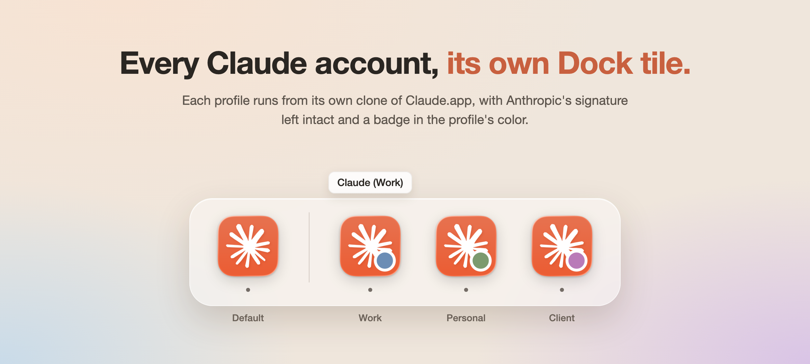
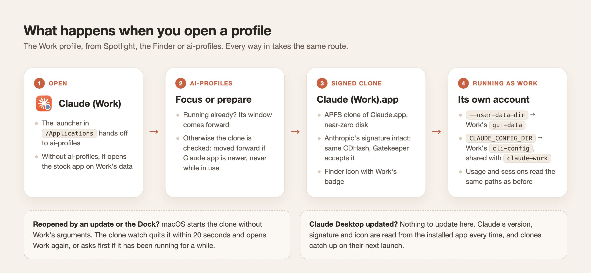
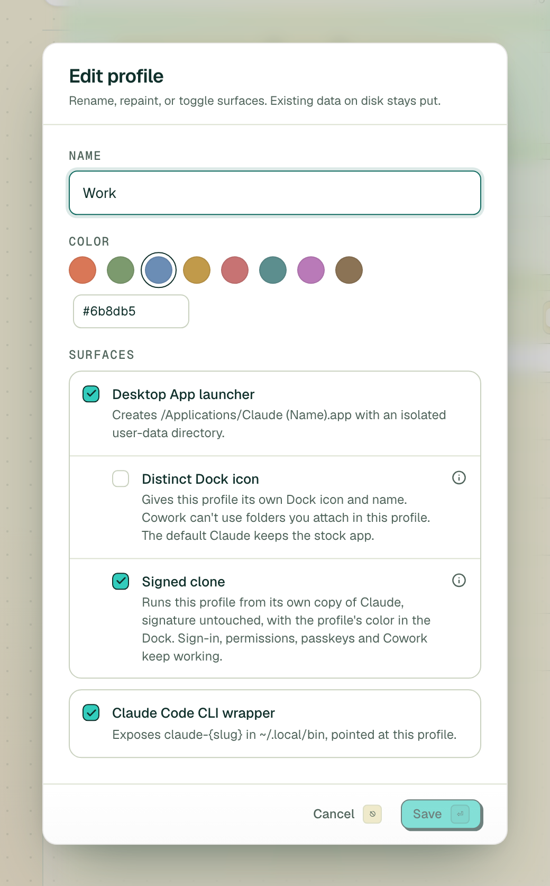

# claude-switch

<p align="center">
  
</p>
<p align="center"><sub>Illustration built from the icons claude-switch renders. Whether the macOS 26 Dock shows a clone's custom icon is still on the <a href="docs/signed-clone-verification.md">verification list</a> (D2).</sub></p>

Run several Claude accounts on one Mac, side by side: Claude Desktop and Claude Code, each account in its own profile, each profile with its own Dock tile. ChatGPT and Codex accounts work the same way. Coding sessions can move from one account to another.

Claude profiles can run from a **signed clone**: a copy of Claude.app that keeps Anthropic's signature, so sign-in, permissions, passkeys and Cowork behave as they do in the original, badged in the profile's color so you can tell the profiles apart.

> **Status**: the signed clone mode is implemented but not yet verified at runtime. Static checks (clone, signature, Gatekeeper) and the unit and E2E tests pass. Sign-in, permissions, the Dock and updates still need checking with the [verification guide](docs/signed-clone-verification.md).

## What you get

- **A profile per account.** Each one gets a desktop launcher, `/Applications/Claude (<Name>).app`, and a CLI command, `claude-<slug>`. Both open with that account's login, history and settings, isolated from the others.
- **Its own Dock tile.** A Claude profile can run from a signed clone wearing the profile's color, from a re-signed copy with its own icon and name, or simply from the stock app.
- **Usage at a glance.** Each profile shows its current quota: the 5-hour and weekly windows.
- **Sessions that move.** List a profile's Claude Code and Codex sessions, archive them, or move one to another account and carry on there.
- **Your existing setup, imported.** Already using Claude Desktop or Claude Code? Bring it into your first profile.

## The signed clone mode

| | Stock app (default) | Distinct Dock icon | **Signed clone** |
|---|---|---|---|
| What runs | `/Applications/Claude.app` | A copy re-signed on this Mac | An APFS clone, signature untouched |
| Told apart in the Dock | No | Its own icon and name | Claude's icon with a badge in the profile color |
| Keychain, permissions, passkeys, Cowork | Work | Sign in again, permissions asked again, no Cowork folders | Work (expected) |
| Claude's own updates | The original updates | The copy is rebuilt | The clone updates itself, and only ever moves forward |

<p align="center">
  
</p>

- **Turning it on**: in Create or Edit profile, turn on **Signed clone** under the desktop launcher. It is offered for Claude profiles, and can't be combined with Distinct Dock icon.

  <picture>
    <source media="(prefers-color-scheme: dark)" srcset="docs/assets/signed-clone-option-dark.png">
    
  </picture>

- **What it creates**:
  - `~/Library/Application Support/claude-switch/profiles/<id>/app.noindex/Claude (<Name>).app` — the clone. It's a cache: delete it and it is made again on the next launch.
  - `/Applications/Claude (<Name>).app` — the launcher. It hands launches to the app, and opens the stock Claude if the app is gone.
  - `~/Library/LaunchAgents/app.claude-switch.clone-watch.plist` — the clone watch, installed only while some Claude profile uses a signed clone or the stock app (the stock app needs it for first sign-in).
- **Your data stays where it is**: the clone runs on the profile's own `gui-data` (`--user-data-dir`) and `cli-config` (`CLAUDE_CONFIG_DIR`). Account data is never moved or deleted automatically, and a running clone is never replaced.
- **Already running?** Opening the profile brings its window forward.
- **Reopened by an update or the Dock?** macOS starts the clone without the profile's arguments. Within 20 seconds it is quit and reopened as the profile; an older one is only quit after asking, and an update that left a profile closed is reported in a notification.
- **Claude Desktop updated?** Nothing to update here. Claude's version, executable, signing requirement and icon are read from the installed app every time, and clones catch up on their next launch.
- **First sign-in**: while the profile runs signed out, claude-switch opens `claude://` links in Claude's place. Claude then does its Google sign-in in a system sheet that answers the profile's own window, instead of a `claude://` link that would land in whichever Claude is running. Links that come in meanwhile are passed on to Claude, and the scheme goes back to Claude once the profile has signed in or quit. Claude profiles on the stock app get the same; those with a distinct Dock icon don't need it.

More: [design](docs/signed-clone-design.md) · [verification guide](docs/signed-clone-verification.md)

## Supported apps

| App | Desktop launcher | CLI wrapper | Where the login lives |
|-----|------------------|-------------|-----------------------|
| **Claude** (Desktop + Claude Code) | `Claude (<Name>).app` | `claude-<slug>`, sets `CLAUDE_CONFIG_DIR` | A macOS Keychain entry derived from the profile's config dir |
| **ChatGPT** (Desktop) + **Codex** (CLI) | `ChatGPT (<Name>).app` | `codex-<slug>`, sets `CODEX_HOME` | `auth.json` inside the profile's `CODEX_HOME` |

## Install

Download the `.dmg` from the [latest release](https://github.com/rokrokss/claude-switch/releases/latest), open it and drag claude-switch to Applications. It is a universal build for Apple Silicon and Intel Macs, signed with a Developer ID and notarized by Apple. The app keeps its data in `~/Library/Application Support/claude-switch/`.

The app checks this repository's releases for a new version at launch and every 6 hours, and offers to restart and install it. It installs only updates signed with this project's key.

**Updating from 1.4.0**: 1.4.0 shipped before the project had its own update key, so it can't verify updates. It will show the next release as available, but installing it from the app fails. Download that release's `.dmg` and drag claude-switch to Applications once. From then on, updates install from the app.

Or build it from source:

```sh
pnpm install
pnpm --filter claude-switch tauri build --bundles app --config '{"bundle":{"createUpdaterArtifacts":false}}'
```

The `--config` override skips the signed update archive, which needs the release signing key. Then copy `apps/claude-switch/src-tauri/target/release/bundle/macos/claude-switch.app` to `/Applications`. A build from source isn't notarized, so open it the first time with right-click → Open.

## Using it

Create a profile from the sidebar: choose an app (Claude or ChatGPT), give it a name, pick a color, and choose the surfaces you want.

- **Desktop app.** A `Claude (<Name>).app` or `ChatGPT (<Name>).app` launcher lands in `/Applications`. Spotlight, Launchpad, the Finder and ⌘-Tab see it as an app of its own, badged with the profile's color.
- **CLI.** A `claude-<slug>` or `codex-<slug>` command appears in `~/.local/bin`. Run it in any terminal to start the CLI with that profile's config and login.

Switch profiles from the sidebar: ⌘1…⌘9 jump to a slot, ⌘F filters the list, ⌘K opens the command palette, ⌘N creates a profile and ⌘, opens Settings.

Deleting a profile removes its launcher and CLI wrapper; its data goes to the Trash or is deleted outright, as you choose.

### What profiles share

Profiles separate your **account**, not your way of working. Skills, subagents, slash commands and your global instructions describe how you work, so a new profile inherits them from your main install (`~/.claude` or `~/.codex`):

| Inherited from your main install | Kept separate per profile |
|----------------------------------|---------------------------|
| `skills/`, `agents/`, `commands/`, `rules/`, `workflows/`, `output-styles/` | Account and credentials (Keychain entry or `auth.json`) |
| `CLAUDE.md` for Claude, `AGENTS.md` for Codex | `settings.json`, including `hooks` and `permissions` |
| | `plugins/`, MCP servers, session and project history |

Anything executable or credentialed stays isolated: a hook added for one account can't fire in another, and a permissive allowlist can't leak into a work profile.

The inherited entries are symlinks, created only over an empty path. To give a profile its own copy, replace the link with a real directory:

```sh
cd ~/Library/Application\ Support/claude-switch/profiles/<id>/cli-config
rm skills && mkdir skills
```

Profiles imported from an existing install hold their own copy of everything and inherit nothing.

### Usage stats

A profile's detail page shows its current quota, refreshed every 5 minutes while visible, or on demand with ↻.

- **Claude**: the rolling 5-hour window, the 7-day window and the 7-day Sonnet window, from Anthropic's `/api/oauth/usage` endpoint with the profile's own OAuth token. The endpoint and the Keychain naming are undocumented; if either changes, the meters show `—`.
- **Codex**: the 5-hour and weekly windows, read through `codex app-server` (`account/rateLimits/read`) from the profile's own `auth.json`.

The first refresh asks for Keychain access; choose "Always Allow".

### Sessions

Each profile lists its local coding sessions: Claude Code for Claude profiles (the CLI and the desktop app's Code tab), Codex for ChatGPT profiles. Chats on claude.ai and in ChatGPT live on the server and don't appear here.

- **Move a session to another account** of the same app, including your default install, and carry on there with its full history. Nothing is deleted: the session is copied, then archived at the source, so **Restore** undoes a move. A file the move would overwrite is backed up first.
- **Archive and restore.** Desktop sessions use the desktop app's own archive flag, CLI-only Claude sessions move into `<config>/claude-switch-archive/` (out of reach of Claude Code's 30-day cleanup), and Codex sessions use Codex's own archive.
- **Search and filter** by title, folder or last prompt, Desktop or CLI, sorted by last use.

A session open in a terminal can't be moved or archived until it is closed. If the desktop app has it open, the confirmation offers to quit that profile's instance, and only that one.

### Importing an existing install

On first launch, or later from Settings → Data → "Detect and import…" (⌘I), the app can adopt your existing `~/.claude` and `~/Library/Application Support/Claude` (or `~/.codex` and `~/Library/Application Support/Codex`) as your first profile. It:

1. copies your data into the new profile,
2. moves the originals into `~/Library/Application Support/claude-switch/migration-backup-<timestamp>/`,
3. creates the profile's launcher and CLI wrapper.

Afterwards use `claude-<slug>` (or `codex-<slug>`) for that account. Claude profiles ask you to sign in once, since the Keychain entry follows the config dir.

Backups are kept for 7 days. To undo an import before then, delete the profile and move the originals back:

```sh
mv ~/Library/Application\ Support/claude-switch/migration-backup-<timestamp>/.claude ~/.claude
mv ~/Library/Application\ Support/claude-switch/migration-backup-<timestamp>/Claude ~/Library/Application\ Support/Claude
```

## Development

```sh
(cd apps/claude-switch/src-tauri && cargo test -- --test-threads=1)
NODE_OPTIONS=--no-webstorage pnpm --filter claude-switch test   # needed on Node 25+, whose built-in localStorage clashes with happy-dom
```

`pnpm install` also installs lefthook git hooks. On current stable clippy (1.93), the pre-push hook's `cargo clippy --all-targets` fails on two lints in existing test code (`test_support.rs`, `profiles.rs`). CI checks without `--all-targets` and passes. To skip the hooks, install with `pnpm install --ignore-scripts`, or push with `LEFTHOOK=0 git push` once they're installed.

Releases are built, notarized and published from a Mac with `scripts/release.sh`. See [Releasing](docs/releasing.md).

## FAQ

**Why does a profile ask me to sign in to Claude Code again after importing?**
Claude Code names its Keychain entry after the config directory, which changes when your install moves into a profile. Sign in once per profile.

**A new `claude-<slug>` command isn't found.**
`~/.local/bin` isn't on your `PATH`. Use Settings → System → "Install / re-install hook", or add it to your shell config, then open a new terminal.

**The usage meters show `—`.**
Claude: the undocumented quota endpoint may have changed shape. Codex: the `codex` CLI isn't on your `PATH`, or its protocol changed.

**Does it send my data anywhere?**
No. There is no analytics, telemetry or remote logging. Its network requests are the usage lookups above, made with each profile's own credentials, and the update check: it reads `latest.json` from this repository's latest release, and downloads the update only when you install it.

**Can I run it next to another build of this app?**
Not on the same data directory. A build that doesn't know `signedClone` drops the field when it saves, and that profile falls back to the stock launcher (its data is safe).

## License

MIT — see [LICENSE](LICENSE).

claude-switch is not affiliated with or endorsed by Anthropic or OpenAI. "Claude" and the Claude icon are Anthropic's, and "ChatGPT" and "Codex" are OpenAI's. The icons shown here are what the app draws from the Claude.app installed on the Mac.
