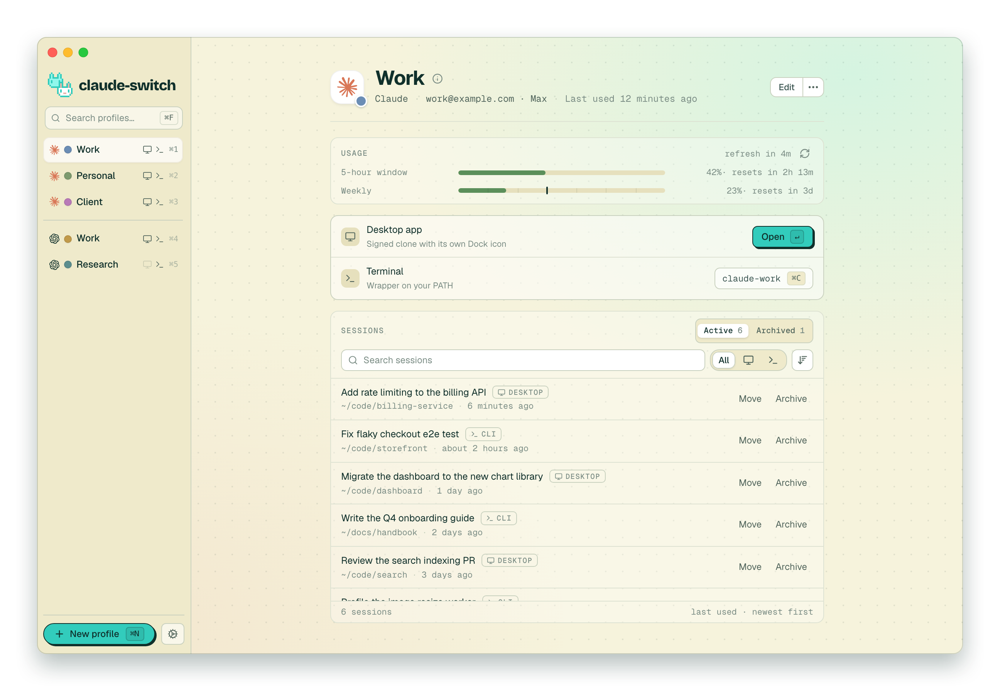

# claude-switch

[ai-profiles](https://github.com/bartekczyz/ai-profiles)(`54b8259`, MIT)를 가져와, macOS Claude Desktop용 **signed clone 실행 모드**를 더한 포크입니다. ai-profiles의 프로필 저장 구조, 인증 경로, 사용량 조회, 세션 이동은 그대로 둡니다. 그 위에서 Claude 프로필마다 서명을 건드리지 않은 Claude.app 복제본을 띄웁니다.

> **상태**: 구현은 끝났고, 실제 실행 검증은 아직입니다. 정적 검사(복제·서명·Gatekeeper)와 단위·E2E 테스트는 통과했습니다. 로그인, 권한, Dock, 업데이트 동작은 [검증 가이드](docs/signed-clone-verification.md)에 따라 확인해야 합니다.

## signed clone 모드

| | script (기본) | Distinct Dock icon (wrapper) | **Signed clone** |
|---|---|---|---|
| 실행되는 앱 | `/Applications/Claude.app` | 재서명한 복제본 | 서명을 그대로 둔 APFS 복제본 |
| Dock 구분 | 안 됨 | 프로필 아이콘 | Finder 사용자 지정 아이콘 (프로필 색) |
| Keychain·권한·passkey·Cowork | 정상 | 다시 로그인·권한 재요청, Cowork 폴더 불가 | 정상 (예상) |
| Claude 자동 업데이트 | 원본 | 다시 빌드 | 복제본이 스스로 업데이트하고, 버전은 앞으로만 감 |

- **켜는 법**: 프로필 생성·편집에서 Desktop launcher 아래의 **Signed clone**을 켭니다. Claude 프로필에서만 보입니다. Distinct Dock icon과는 함께 켤 수 없습니다.
- **만들어지는 것**:
  - `~/Library/Application Support/ai-profiles/profiles/<id>/app.noindex/Claude (<Name>).app` — 복제본. 캐시라서 지워도 다시 만들어집니다.
  - `/Applications/Claude (<Name>).app` — launcher. ai-profiles로 실행을 넘기고, ai-profiles가 없으면 원본을 엽니다.
  - `~/Library/LaunchAgents/app.ai-profiles.clone-watch.plist` — 감시 에이전트. signed clone 프로필이 있을 때만 설치됩니다.
- **기존 데이터 경로를 그대로 씁니다**: `gui-data`(`--user-data-dir`)와 `cli-config`(`CLAUDE_CONFIG_DIR`). 계정 데이터는 자동으로 옮기거나 지우지 않고, 실행 중인 복제본은 교체하지 않습니다.
- **실행 중이면** 그 프로필의 창을 앞으로 가져옵니다.
- **업데이트나 Dock 클릭으로 인자 없이 다시 떴을 때**: 20초 이내면 자동으로 종료하고 프로필로 다시 엽니다. 그보다 오래됐으면 확인을 받고, 업데이트 후 열리지 않은 경우에는 알림을 보냅니다.
- **Claude Desktop이 업데이트되어도 이 앱은 업데이트할 필요가 없습니다**: Claude 버전, 실행 파일, 서명 요건, 아이콘을 모두 실행할 때마다 설치된 앱에서 읽습니다.
- **처음 로그인할 때는** 다른 Claude 창을 모두 종료하세요. `claude://` 로그인 링크는 실행 중인 Claude 중 하나로 갑니다.

자세한 내용: [설계](docs/signed-clone-design.md) · [검증 가이드](docs/signed-clone-verification.md)

## 빌드

```sh
pnpm install
pnpm --filter ai-profiles tauri build --bundles app --config '{"bundle":{"createUpdaterArtifacts":false}}'
# → apps/ai-profiles/src-tauri/target/release/bundle/macos/ai-profiles.app 를 /Applications 로 복사
```

테스트는 다음과 같이 돌립니다.

```sh
(cd apps/ai-profiles/src-tauri && cargo test -- --test-threads=1)
NODE_OPTIONS=--no-webstorage pnpm --filter ai-profiles test   # Node 25+에서는 내장 localStorage가 happy-dom과 충돌해서 필요
```

`pnpm install`은 lefthook git 훅도 설치합니다. 그중 pre-push 훅의 `cargo clippy --all-targets`는 최신 stable clippy(1.93)에서 upstream 원본 테스트 코드의 lint 2건(`test_support.rs`, `profiles.rs`) 때문에 실패합니다. CI는 `--all-targets` 없이 검사하므로 통과합니다. 훅이 필요 없으면 `pnpm install --ignore-scripts`로 설치하고, 이미 설치했다면 `LEFTHOOK=0 git push`로 건너뛰면 됩니다.

## 원본과의 차이와 주의

- upstream의 release-please·release 워크플로를 제거했습니다(upstream secret이 필요해 이 저장소에서는 실패합니다). CI는 그대로 둡니다.
- 앱 updater가 이 저장소의 Releases를 봅니다. 릴리스가 없으므로 자동 업데이트도 없습니다. upstream 빌드로 덮어써지는 것을 막기 위해서입니다.
- 데이터 디렉터리와 식별자(`ai-profiles`, `app.ai-profiles.*`)는 원본과 같습니다. **원본 ai-profiles 앱과 동시에 쓰지 마세요.** 원본은 `signedClone`을 모르므로 저장할 때 이 필드가 사라지고, 해당 프로필은 script 모드로 돌아갑니다(데이터는 안전합니다).

---

아래는 원본 ai-profiles README입니다.

## ai-profiles

> Run multiple Claude and ChatGPT accounts on one Mac — the desktop app and the CLI, side by side — and move coding sessions between them. Free and open-source.

<picture>
  <source media="(prefers-color-scheme: dark)" srcset="apps/landing/public/screenshot-dark.png">
  
</picture>

## Landing page

The marketing landing page lives in [`apps/landing/`](apps/landing/README.md) (Astro + Tailwind, deployed to Vercel).

## Install

### Download

Download the latest `.dmg` from [Releases](https://github.com/bartekczyz/ai-profiles/releases/latest). Open it, drag `ai-profiles.app` to `/Applications`. Launch.

### Build from source

```sh
git clone https://github.com/bartekczyz/ai-profiles.git
cd ai-profiles
pnpm install
pnpm --filter ai-profiles tauri build
```

The `.dmg` lands in `apps/ai-profiles/src-tauri/target/release/bundle/dmg/`. macOS will warn on first launch because the local build isn't notarized — right-click the `.app` → Open → Open to bypass Gatekeeper.

## Supported apps

| App | Desktop launcher | CLI wrapper | Auth isolation |
|-----|-----------------|-------------|----------------|
| **Claude** (Desktop + Claude Code CLI) | `Claude (<Name>).app` | `claude-<slug>` (sets `CLAUDE_CONFIG_DIR`) | macOS Keychain entry derived from config dir |
| **ChatGPT** (Desktop) + **Codex** (CLI) | `ChatGPT (<Name>).app` | `codex-<slug>` (sets `CODEX_HOME`) | plain `auth.json` inside profile's `CODEX_HOME` — isolation is automatic |

## Using ai-profiles

Create a profile from the sidebar — choose an app (Claude or ChatGPT), give it a name, pick a colour, and choose which surfaces you want (desktop app, CLI, or both). The app generates everything you need on the spot:

- **Desktop app.** A `Claude (<Name>).app` or `ChatGPT (<Name>).app` launcher lands in `/Applications`. Double-click to open the app with that profile's account, history, and settings. Spotlight, Launchpad, Finder, and ⌘-Tab all see it as its own app, tinted with the profile colour.
- **CLI.** A `claude-<slug>` or `codex-<slug>` command appears on your `PATH`. Run it in any terminal to start the CLI with that profile's config and login. Each profile keeps its own session and credentials.

Switch profiles from the sidebar, with ⌘1..⌘9 to jump to a slot, ⌘F to filter the list, or ⌘K to open the command palette. ⌘N creates a new profile, ⌘, opens Settings.

Already using Claude Desktop, Claude Code, or ChatGPT/Codex? On first launch the app offers to import your existing setup into your first profile. You can rerun this later from Settings → Data → "Detect and import…".

Deleting a profile from its detail view removes the launcher and CLI wrapper; the profile's data either goes to the Trash or is deleted outright, your choice.

### What profiles share

Profiles separate your **account**, not your working setup. Skills, subagents, slash commands and your global instructions are inert content describing how you work, so a new profile inherits them from your main install (`~/.claude` or `~/.codex`) instead of starting empty:

| Inherited from your main install | Kept separate per profile |
|----------------------------------|---------------------------|
| `skills/`, `agents/`, `commands/`, `rules/`, `workflows/`, `output-styles/` | account and credentials (Keychain entry / `auth.json`) |
| `CLAUDE.md` for Claude, `AGENTS.md` for Codex — your global instructions | `settings.json`, including `hooks` and `permissions` |
| | `plugins/`, MCP servers, session and project history |

Anything executable or credentialed stays isolated: a hook you add for one account can't fire inside another, and a permissive tool allowlist can't leak into a work profile.

The inherited entries are symlinks, written into the profile's config dir when its CLI wrapper is generated. They are only ever created over an empty path, so a profile can opt out — give it a real directory and it keeps its own copy from then on:

```sh
cd ~/Library/Application\ Support/ai-profiles/profiles/<id>/cli-config
rm skills && mkdir skills
```

Profiles created by migrating an existing install already hold their own copy of everything, so they inherit nothing.

### Usage stats

Each profile's detail page shows that profile's current quota utilization alongside the launcher and CLI buttons. A small countdown tells you when the next auto-refresh will fire (every 5 minutes while the card is visible), or you can hit the ↻ button to refresh on demand.

**Claude profiles** show three meters: the rolling 5-hour window, the 7-day window, and the 7-day Sonnet sub-window. Under the hood the card calls Anthropic's `/api/oauth/usage` endpoint using the profile's own OAuth token, read from the macOS Keychain entry Claude Code created when you signed in. The quota endpoint and the Keychain naming convention are undocumented Anthropic internals — if either changes, the meters may show `—` until we ship a patch.

**Codex profiles** show two meters: the 5-hour window and the weekly window. The card drives `codex app-server` over its JSON-RPC protocol (`account/rateLimits/read`) — no separate auth is needed because the app-server reads from the profile's own `CODEX_HOME/auth.json` directly.

### Sessions

Each profile's detail page lists its local coding sessions: Claude Code for Claude profiles (the CLI and the Claude desktop app's Code tab), Codex for ChatGPT profiles (the CLI, IDE, and the ChatGPT desktop app). claude.ai and ChatGPT chats live on the server, so they don't appear here.

**Move a session to another account.** Move a session to another profile of the same app and carry on there with its full history. Claude sessions move between Claude profiles, Codex sessions between ChatGPT profiles; you can't move a session from Claude to Codex or back. Moves work with your default install (`~/.claude` / `~/.codex`) too.

- **Claude:** the transcript, its file history, and new project memory files are copied to the destination. If you're signed in to the destination's desktop app, the session shows up there too; otherwise only the CLI half moves.
- **Codex:** the rollout is copied to the destination's `CODEX_HOME` and registered through `codex app-server`.

Nothing is ever deleted. A move copies the session, then archives it at the source, so **Restore** undoes it. A file the move would overwrite is backed up first, and if the destination holds a newer copy you have to opt in to replacing it.

**Archive and restore.** The panel has **Active** and **Archived** tabs. Archiving a desktop session uses the desktop app's own archive flag, so sessions you archived inside Claude show up here too. Archiving a CLI-only Claude session moves it into `<config>/ai-profiles-archive/`, which also keeps it clear of Claude Code's 30-day cleanup. Codex sessions use Codex's own archive.

Search by title, folder, or last prompt, filter Desktop vs CLI, and sort by last used.

A session still open in a terminal can't be moved or archived; close it first. If the desktop app has it open, the confirm dialog offers to quit that profile's instance (and only that one) before it goes ahead.

**Repair.** Claude desktop sessions created before ai-profiles pointed the desktop app at its profile's config dir have their transcripts in `~/.claude`. They list under the profile that owns them, and a banner offers to move them into place.

## Onboarding

**First launch.** A welcome dialog appears once; after that you land on the empty state with a single "+ New profile" CTA. There is no auto-prompt — the next step is on you.

**Creating your first profile when you already have Claude or ChatGPT/Codex installed.** Clicking "+ New profile" opens a fork dialog with two paths:

- **Just add a new profile, keep existing install as-is** (default — press Enter). Leaves your existing install untouched. `claude` or `codex` keeps working with your current account. The new profile is fully separate and accessed via `claude-<slug>` or `codex-<slug>`.
- **Migrate existing install into a profile.** Adopts your existing `~/.claude` (and `~/Library/Application Support/Claude` if Claude Desktop is installed), or `~/.codex` (and `~/Library/Application Support/Codex` if the ChatGPT desktop app is installed), as your first profile. See "What migrate does" below.

### What migrate does

Three steps, in order:

1. **Copies** your existing data into the new profile dir under `~/Library/Application Support/ai-profiles/profiles/<id>/`. Symlinks stay symlinks, with relative targets re-pointed so they still resolve once the originals move in step 2 — skill managers routinely install links that reach outside `~/.claude`.
2. **Moves** the originals (`~/.claude` and/or `~/Library/Application Support/Claude` for Claude; `~/.codex` and/or `~/Library/Application Support/Codex` for Codex) into a timestamped backup dir under `~/Library/Application Support/ai-profiles/migration-backup-<timestamp>/`.
3. **Generates** the per-profile launcher (`Claude (<Name>).app` or `ChatGPT (<Name>).app`) and CLI wrapper (`claude-<slug>` or `codex-<slug>` in `~/.local/bin`).

### After migrating

- Use `claude-<slug>` instead of `claude` (or `codex-<slug>` instead of `codex`) to reach your old account. The wrapper sets `CLAUDE_CONFIG_DIR` (Claude) or `CODEX_HOME` (Codex) to the profile dir.
- The plain `claude` or `codex` command still works, but with no `~/.claude` / `~/.codex` present it'll start a fresh install dir on next invocation. It's not broken — it just sees an empty config.
- **Claude profiles:** you'll be prompted to log in once. macOS Keychain service names are derived from `CLAUDE_CONFIG_DIR`, so credentials don't carry across.
- **Codex profiles:** auth is stored in `auth.json` inside `CODEX_HOME`, so a `codex login` re-run in the new profile dir is all that's needed.
- Settings, history, MCP config, and project memory all come with the migration.

### Reverting a migration

Backups stay on disk for 7 days, then auto-delete. To roll back manually before then:

For a Claude migration:
```sh
# 1. Delete the profile from ai-profiles (Trash or keep, your choice).
# 2. Restore the originals from the backup dir:
mv ~/Library/Application\ Support/ai-profiles/migration-backup-<timestamp>/.claude ~/.claude
mv ~/Library/Application\ Support/ai-profiles/migration-backup-<timestamp>/Claude ~/Library/Application\ Support/Claude
# 3. Open Claude. It'll see your old config again.
```

For a Codex migration:
```sh
# 1. Delete the profile from ai-profiles (Trash or keep, your choice).
# 2. Restore the originals from the backup dir:
mv ~/Library/Application\ Support/ai-profiles/migration-backup-<timestamp>/.codex ~/.codex
mv ~/Library/Application\ Support/ai-profiles/migration-backup-<timestamp>/Codex ~/Library/Application\ Support/Codex
# 3. Open ChatGPT. It'll see your old config again.
```

### Triggering migration later

If you picked "just add a new profile" but later change your mind, open **Settings → Data → Re-import…** (or press ⌘I). The same migration flow runs.

### Resetting onboarding

**Settings → Reset onboarding flags** shows the welcome dialog (and the fork dialog) again on next launch. It does not touch profiles, backups, or your theme.

## FAQ

**Why do I have to log in to Claude Code again after importing my existing install?**
The Keychain service name is derived from your `CLAUDE_CONFIG_DIR`, which changes when you move into a per-profile directory. The credentials don't carry over. You only need to log in once per profile.

**Why does the Dock show Claude's regular icon instead of my profile's color?**
The launcher `.app` immediately execs the real Claude.app, so the running Dock icon belongs to Claude. The custom color shows up in Spotlight, Finder, Launchpad, and Cmd-Tab — anywhere the launcher itself is referenced. We're tracking better Dock-icon options for v1.1.

**My new profile launcher doesn't open as `claude-<slug>` from my terminal.**
`~/.local/bin` isn't on your PATH. Open Settings → System and click "Install / re-install hook", or add the line manually to your `.zshrc` / `.bashrc` / `config.fish`. Open a new terminal to pick up the change.

**I installed a new skill and my profile's CLI doesn't see it.**
Profiles link to the skills in your main install, so anything you install there shows up in every profile with no extra step. If a profile sees *no* inherited skills at all, its links haven't been written yet — they're created whenever the profile's CLI wrapper is generated, so editing the profile (changing its colour, say) will produce them. Profiles that migrated an existing install keep their own copy and inherit nothing by design.

**I put an `AGENTS.md` in my Claude config dir and nothing happened.**
Claude Code reads `AGENTS.md` at project scope only; its user-scope instructions file is `CLAUDE.md`. Codex is the other way round and reads `~/.codex/AGENTS.md`. That's why the table above names a different file per app.

**Does this send any of my data anywhere?**
No. The app is local-only and has no analytics, no telemetry, no remote logging. Auto-update checks the GitHub Releases manifest and that's the only outbound request.

**Can I migrate later if I skipped the first-run prompt?**
Yes — Settings → Data → "Detect and import…".

**Is this safe? What about my credentials?**
Each Claude profile gets a separate Keychain entry derived from its config directory. We don't read or copy your credentials; Claude Code handles all of that. The CLI isolation behavior depends on undocumented Claude Code internals (its SHA-256 service-name derivation), and could break in a future Claude Code release. If it does we'll patch.

Codex profiles store credentials in a plain `auth.json` inside each profile's `CODEX_HOME` directory. Isolation is automatic — there is no Keychain involvement.

**The usage meters on the profile detail page show `—` instead of numbers — what's wrong?**
For Claude profiles, the card calls Anthropic's `/api/oauth/usage` endpoint, which is undocumented and may change shape without notice. If the response stops matching what we parse, the affected meters render as `—` rather than crashing. Note that the first refresh after a fresh install triggers a macOS Keychain access prompt — click "Always Allow" so it doesn't recur.

For Codex profiles, the card drives `codex app-server` over JSON-RPC. If the Codex CLI is not on your `PATH` or the JSON-RPC protocol changes, the meters will show `—`. File an issue and we'll patch.

**Why "Settings" instead of "Preferences"?**
macOS deprecated "Preferences" in favor of "Settings" in Ventura. We follow the current convention.

## Support

If ai-profiles saves you time, you can [buy me a coffee](https://buymeacoffee.com/bartekczyz). It helps keep the project active — thanks!

## Not affiliated with Anthropic or OpenAI

ai-profiles is an independent project. It is not endorsed by, affiliated with, or supported by Anthropic or OpenAI. "Claude" and "Anthropic" are trademarks of Anthropic, PBC. "Codex" and "ChatGPT" are trademarks of OpenAI.

## Acknowledgements

ai-profiles is inspired by [Multi-Claude](https://multiclaude.app/), a paid macOS app that pioneered the `--user-data-dir` profile-wrapper approach for Claude Desktop. ai-profiles extends the idea to the Claude Code CLI and ships free + open-source.

## License

[MIT](./LICENSE)
